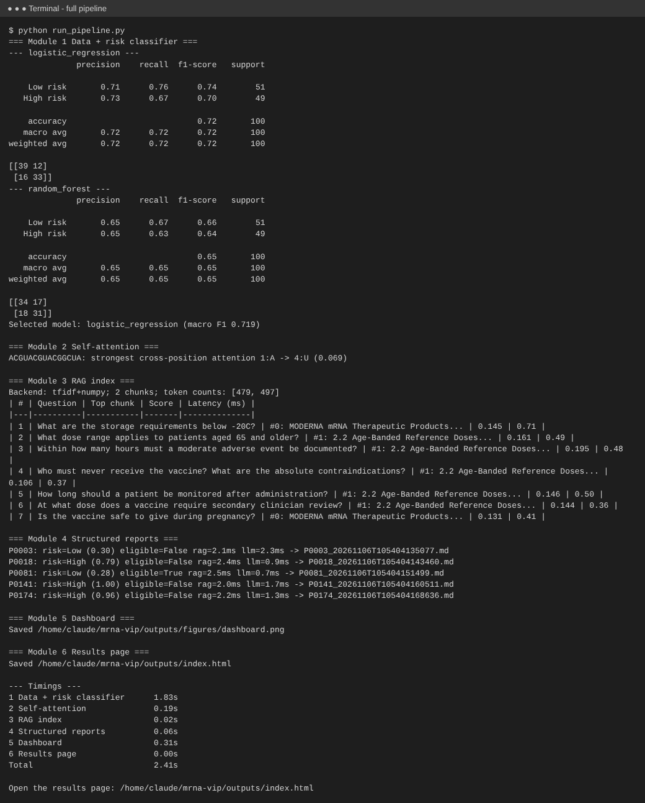
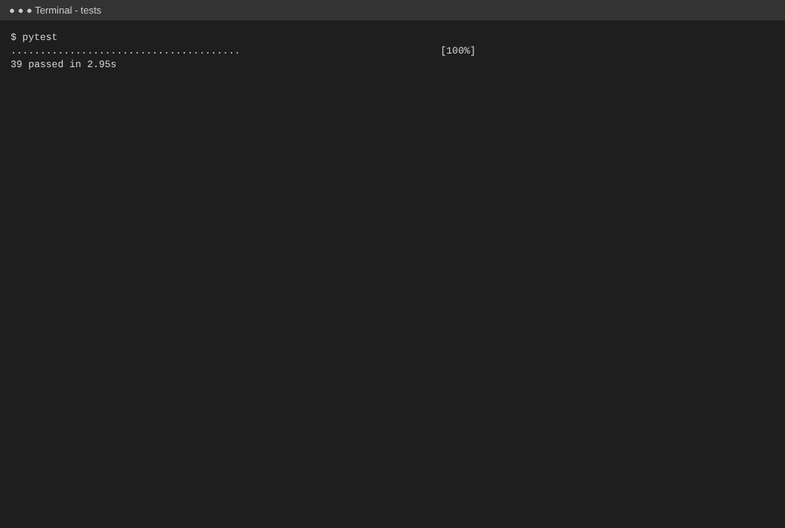
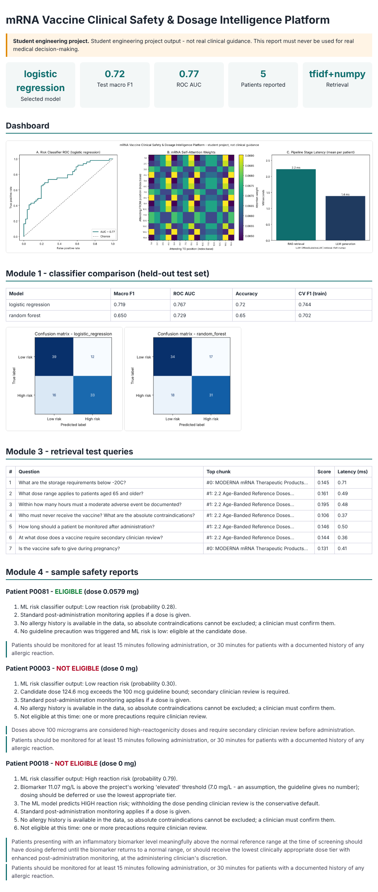
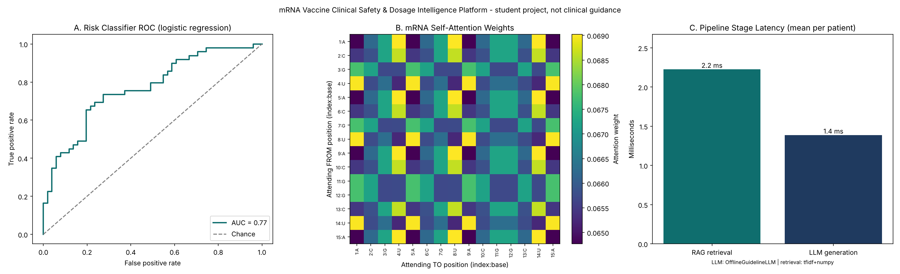
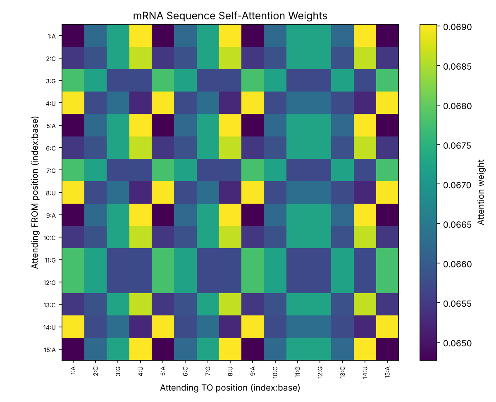
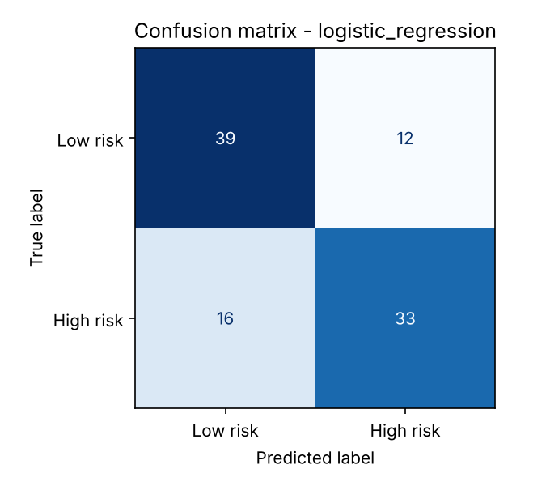
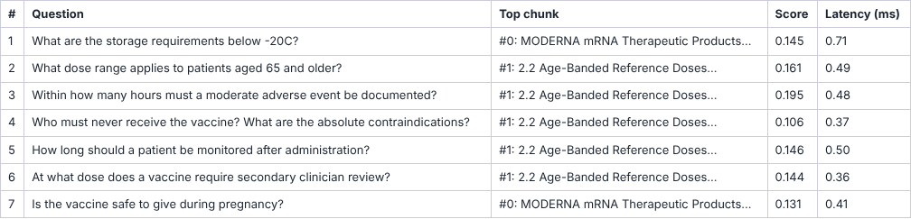
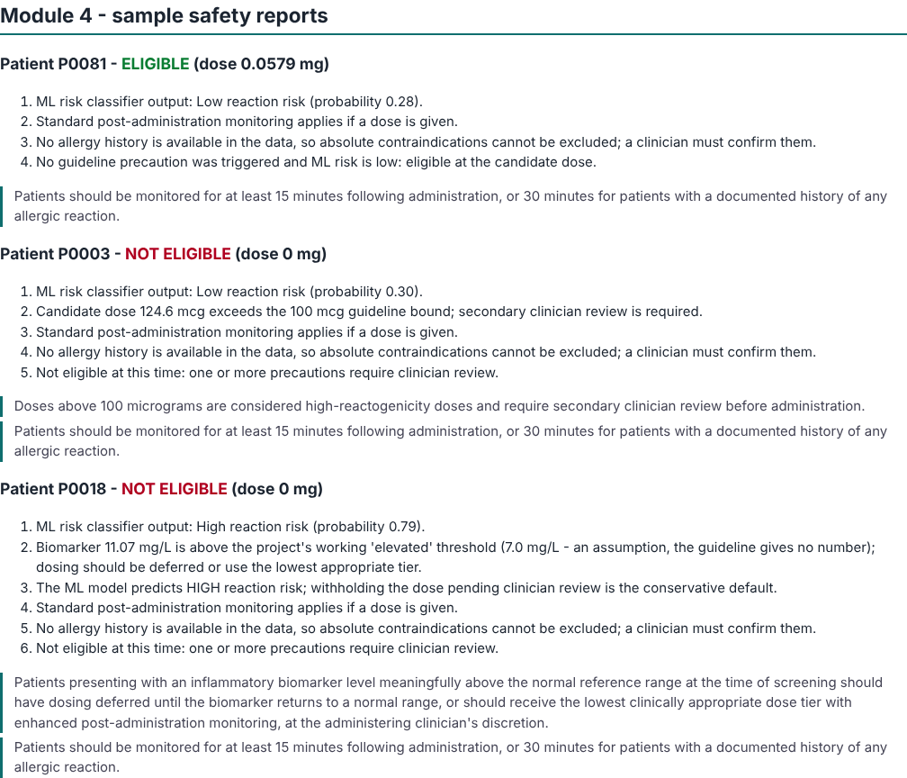

# mRNA Vaccine Clinical Safety & Dosage Intelligence Platform

End-to-end applied-AI case study (classical ML -> self-attention -> RAG -> structured LLM report -> dashboard),
built from the *mRNA-VIP Project PRD*.

> **Disclaimer:** student engineering project. Nothing here is real clinical or regulatory guidance and it
> must never be used for medical decision-making. The dataset contains no real patient data.

## Pipeline

```
patient_records.csv -> [1 Data + ML risk classifier] -> risk label / probability
                    -> [2 Self-attention engine]     -> attention heatmap
guidelines.txt      -> [3 RAG index]                 -> relevant guideline chunks
                    -> [4 Structured report (LLM)]   -> ClinicalSafetyReport .json + .md
                    -> [5 Dashboard]                 -> dashboard.png
```

## Quick start

```bash
python -m venv venv && source venv/bin/activate      # Windows: venv\Scripts\activate
pip install -r requirements.txt
python run_pipeline.py --open     # all modules in ~2 s; opens outputs/index.html in your browser
pytest                            # 39 tests covering FR-1.x - FR-5.x
```

Or run modules one at a time (from the repo root, as modules):
`python -m src.risk_model`, `python -m src.attention`, `python -m src.rag_index`,
`python -m src.report_generator`, `python -m src.dashboard`.

## Screenshots (real output of a run)

| | |
|---|---|
| **Pipeline run (about 2 s)**  | **39 tests passing**  |

**Results page** (`outputs/index.html`, double-click to open) - 

**Dashboard** - 

| Attention heatmap | Confusion matrix (selected model) |
|---|---|
|  |  |

**Retrieval tests** - 

**Structured safety reports** - 

Regenerate them with `python scripts/make_screenshots.py` (needs `pip install playwright && playwright install chromium`).

## Optional: the full GenAI stack (ChromaDB, sentence-transformers, OpenAI/Anthropic)

```bash
pip install -r requirements-genai.txt
cp .env.example .env     # set LLM_PROVIDER=openai|anthropic and the matching API key
python run_pipeline.py
```

Without those extras the project runs **fully offline** using equivalents of the same interfaces:

| Component | Preferred | Offline fallback (automatic) |
|-----------|-----------|------------------------------|
| Embeddings | sentence-transformers `all-MiniLM-L6-v2` | TF-IDF (scikit-learn) |
| Vector store | ChromaDB persistent collection | NumPy `.npz` file |
| Report LLM | OpenAI / Anthropic via LangChain | deterministic rule engine over the retrieved text |

The backend actually used is recorded in `outputs/chroma_store/manifest.json` and shown on the dashboard.
Both fallbacks go through exactly the same validation, grounding checks and guardrails as a real LLM.
**Note:** the ChromaDB / sentence-transformers / LangChain code paths could not be executed where this
project was generated (no internet), so test them on your machine; everything else is tested.

## Repository layout

```
data/        patient_records.csv, mrna_safety_guidelines.txt, patient_records_clean.csv (generated)
notebooks/   01_data_eda.ipynb, 02_attention_math.ipynb
src/         config, data_pipeline, risk_model, attention, rag_index, schemas, report_generator, dashboard, showcase
scripts/     make_screenshots.py
outputs/     index.html (results page), figures/, reports/ (JSON+MD pairs), model + metrics, retrieval log, vector index
tests/       pytest suite
docs/        PROJECT_REPORT.md (portfolio report)
```

## Reproducing each week

| Week | Command | Output |
|------|---------|--------|
| 1 | `python -m src.risk_model` | `data/patient_records_clean.csv`, `outputs/risk_model.joblib`, confusion matrices, `classification_reports.txt`, `model_metrics.json` |
| 2 | `python -m src.attention` | `outputs/figures/attention_heatmap.png` |
| 3 | `python -m src.rag_index` | `outputs/chroma_store/`, `outputs/retrieval_report.md`, `retrieval_log.jsonl` |
| 4 | `python -m src.report_generator [--patient-id P0001] [--provider openai]` | `outputs/reports/*.json` + `*.md`, `latency_log.json` |
| 4 | `python -m src.dashboard` | `outputs/figures/dashboard.png` |

## Design decisions worth knowing

* **The `None` trap.** `pd.read_csv` silently turns the string `None` into NaN. In this data `None` is a real
  category of `Prior_Reaction_History`, so all loaders use `keep_default_na=False, na_values=[""]`.
* **No leakage.** Scaling/encoding live in a scikit-learn `Pipeline`, fitted on the training split only; the
  saved `risk_model.joblib` is the whole pipeline, so it scores raw patient rows.
* **Model selection** is automatic by held-out macro F1 (FR-1.7); logistic regression currently wins.
* **Units.** The data is in micrograms but the PRD's schema field is `Recommended_Dose_mg`; the generator
  converts (1 mg = 1000 mcg) and the prompt says so.
* **Chunking** is a custom sentence-aware packer rather than LangChain's character splitter, because it
  *guarantees* the 300-500 token window (FR-3.1). Tokens are approximated as words + punctuation.
* **Guardrails are code, not prompts.** Citations must be verbatim retrieved text; a dose above the retrieved
  bound forces `Eligible_For_Vaccine=false`; the disclaimer is always overwritten with the canonical text; one
  retry on invalid output, then a clear `ReportGenerationError`.
* **Assumption:** the guideline gives no number for an "elevated" biomarker. The offline engine uses
  `ELEVATED_BIOMARKER_MG_L = 7.0` (about the dataset's 75th percentile), flagged as an assumption in `config.py`
  and in every report that uses it.
* PyTorch is in the PRD's stack but unused: attention is implemented in NumPy (the PRD allows either).

## Security

Never commit `.env` (already git-ignored). Use `.env.example` as the template.
